# Halden: MERN e-commerce store

A full-stack online store built with **MongoDB, Express, React and Node.js**.
Clean editorial design, a professional deep-teal and amber palette, light and dark themes,
and smooth, purposeful motion powered by Framer Motion.

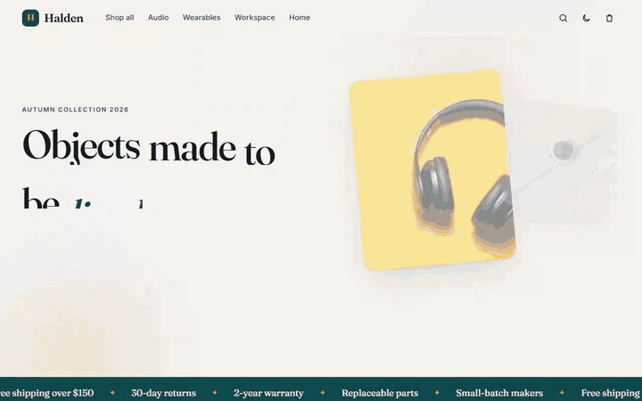

[Watch the full-quality demo video (MP4, 43 s)](docs/demo.mp4)

## Screenshots

| Home | Categories | Featured products |
| --- | --- | --- |
| 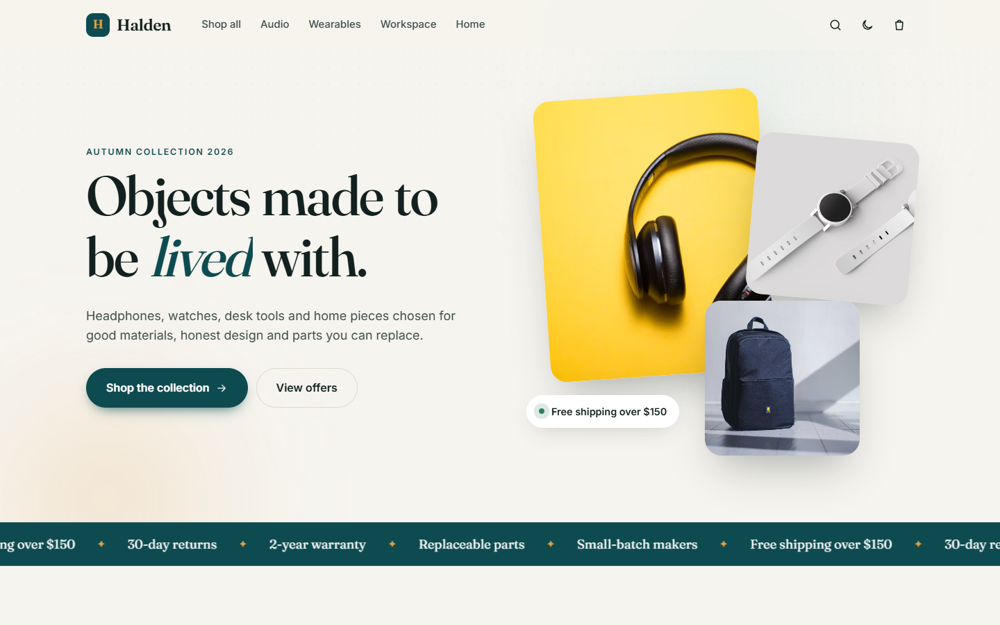 | 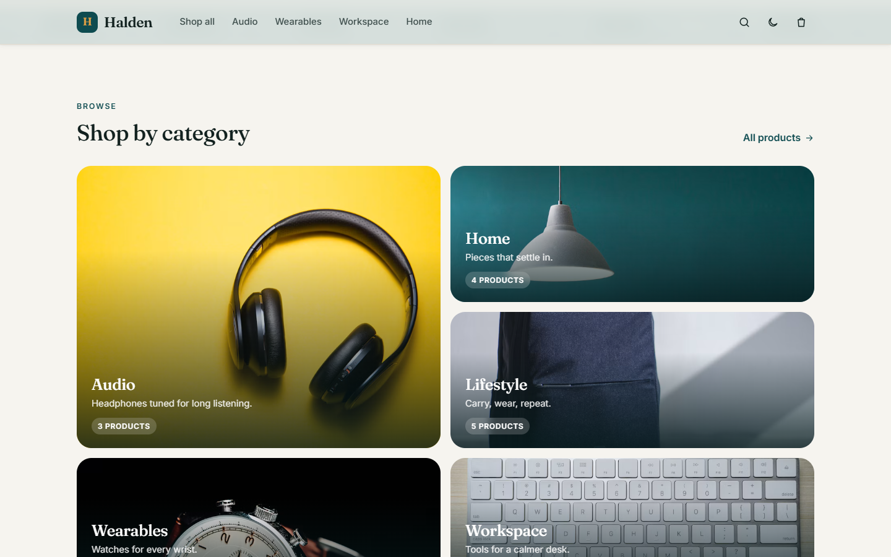 | 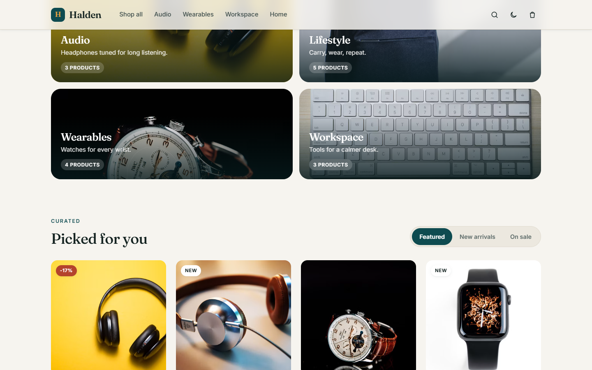 |

| Catalog | Filtered and sorted | Product page |
| --- | --- | --- |
| 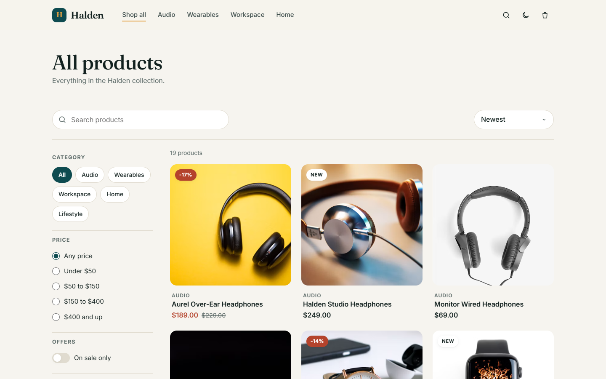 | 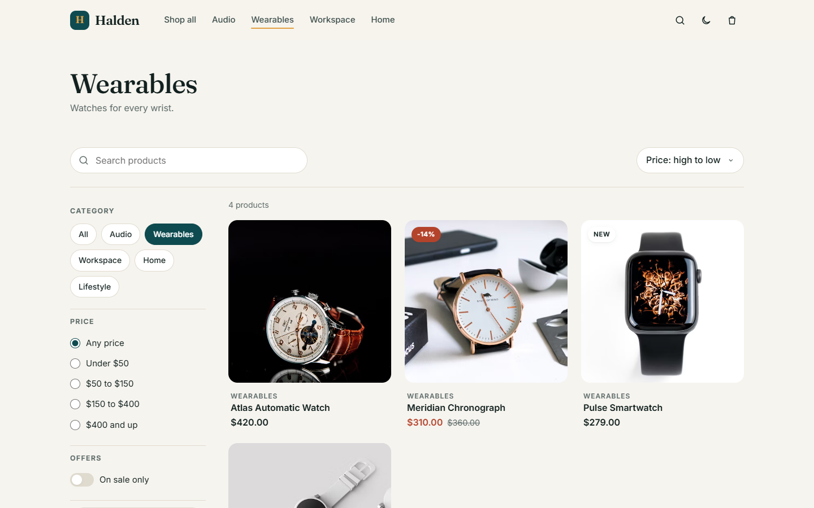 | 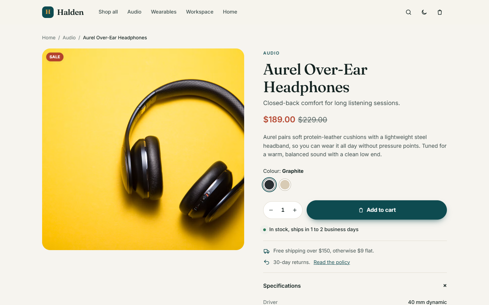 |

| Cart drawer | Checkout | Order confirmation |
| --- | --- | --- |
| 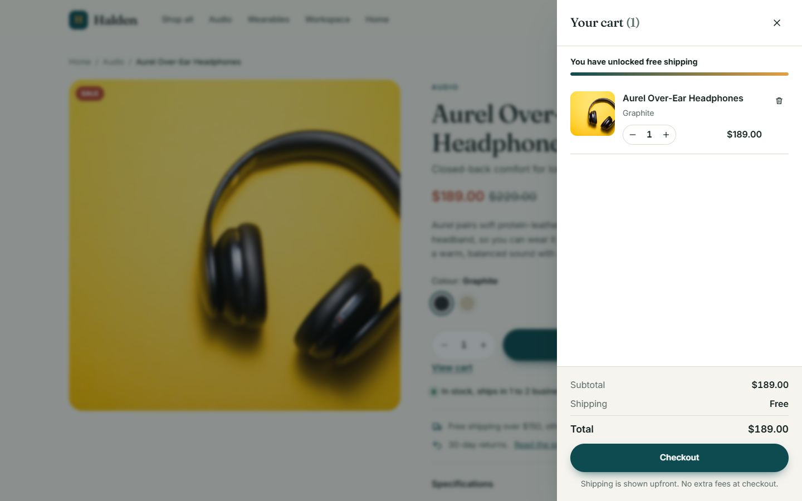 | 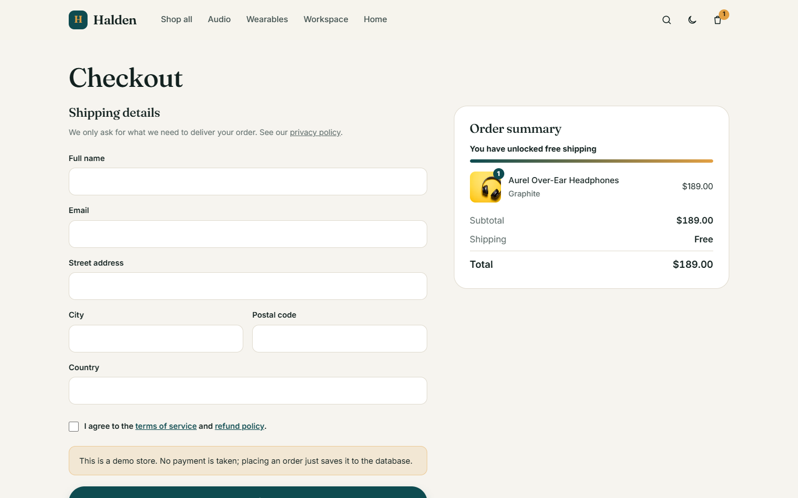 | 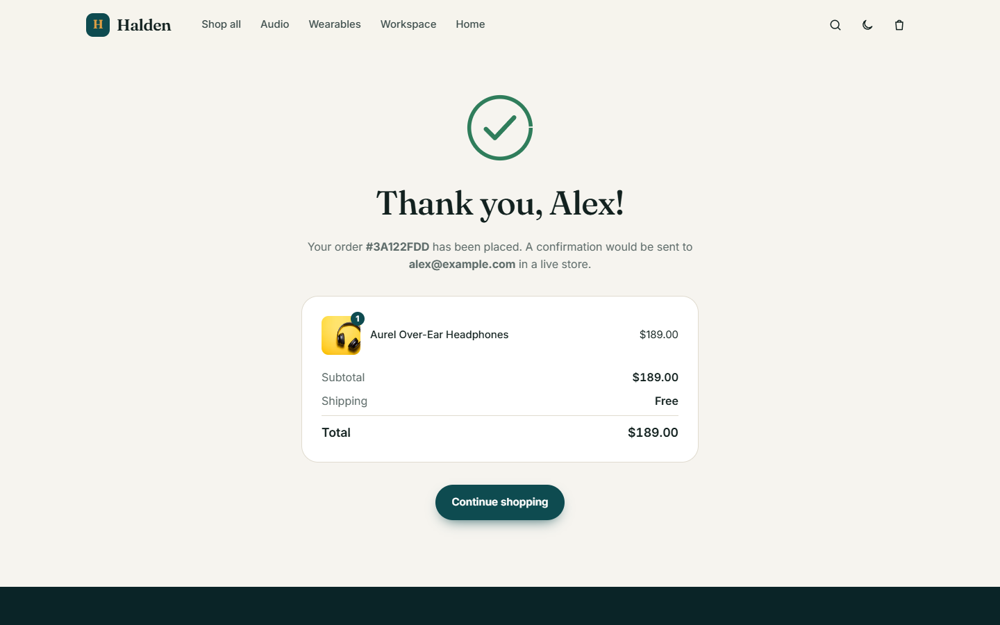 |

| Dark theme: home | Dark theme: product | Story section |
| --- | --- | --- |
| 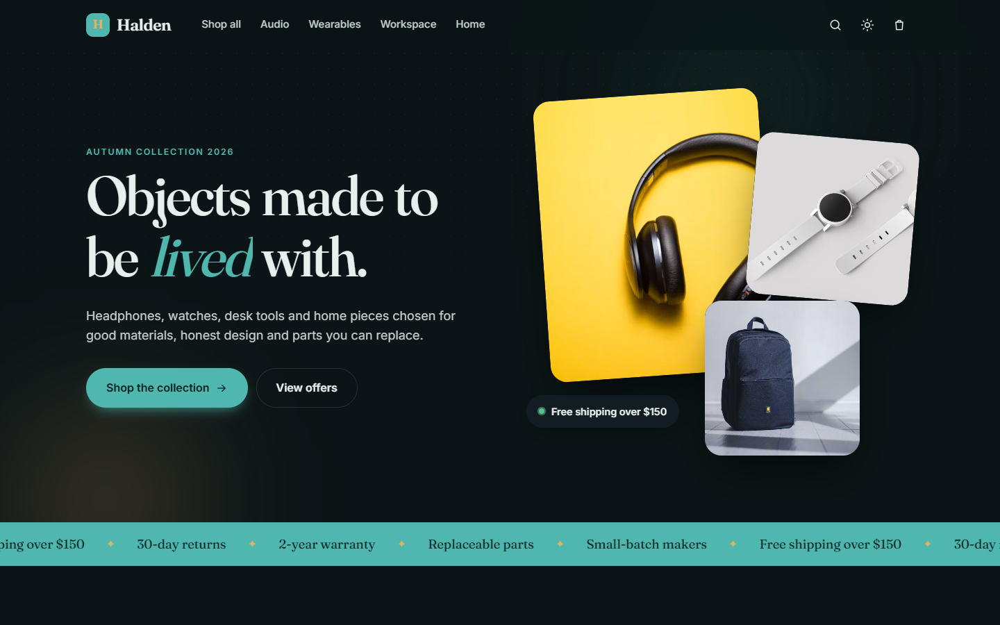 | 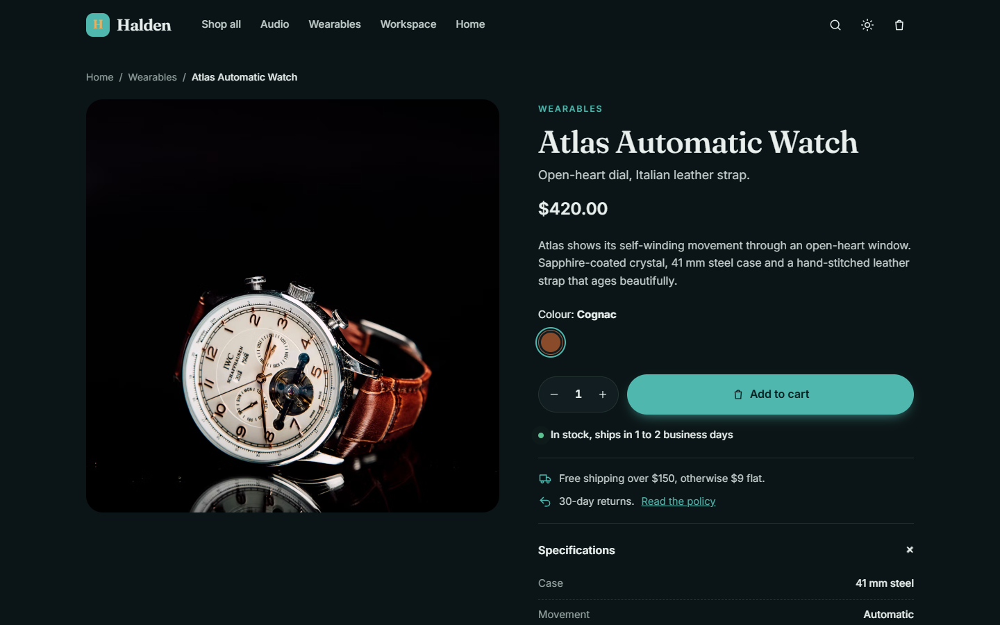 | 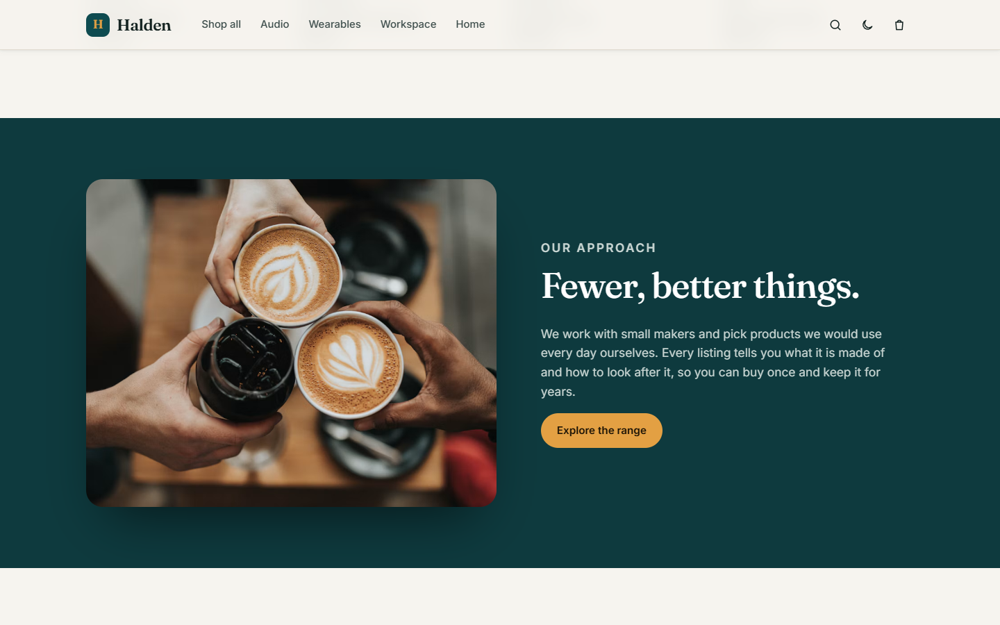 |

<p align="center">
  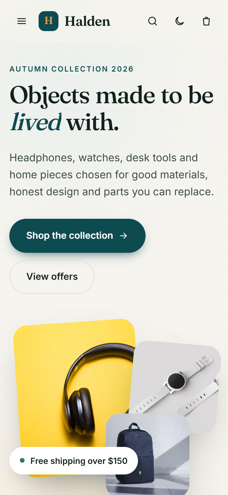
  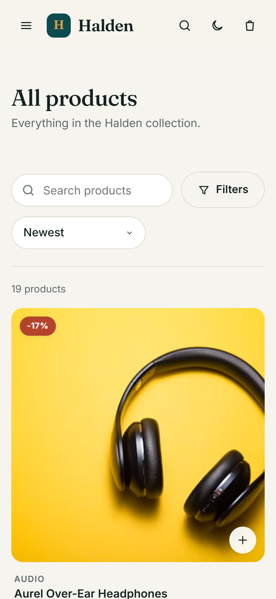
  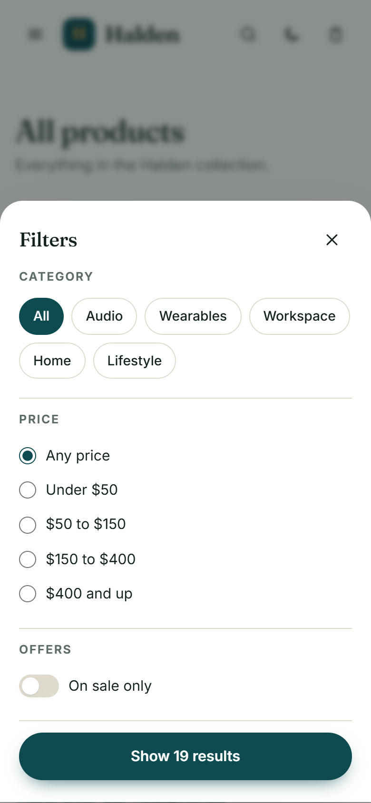
</p>

## Features

**Storefront (React + Vite)**
- Animated hero with word-by-word title reveal and mouse parallax
- Category bento grid, scrolling marquee, scroll-triggered reveals
- Catalog with search (debounced), category chips, price bands, "on sale" switch, sorting and pagination, all synced to the URL
- Product page with hover zoom, colour swatches, quantity stepper, stock indicator, specs and related products
- Slide-out cart drawer with animated free-shipping progress bar, persisted in `localStorage`
- Checkout with client-side validation, accessible error messages and order confirmation page
- Toast notifications, skeleton loaders, animated page transitions
- Light / dark theme (follows the OS by default, remembered per browser)
- Responsive down to 360 px, keyboard accessible, respects `prefers-reduced-motion`

**API (Express + Mongoose)**
- `GET /api/products` with search, category, price range, sale filter, sorting and pagination
- `GET /api/products/featured`, `GET /api/products/categories`, `GET /api/products/:slug`
- `POST /api/orders`: prices are always taken from the database, stock is reserved atomically and rolled back on failure
- `GET /api/orders/:id?email=` (email must match the order)
- Request validation with Zod, Helmet security headers with a strict CSP, rate limiting, compression
- Zero-setup development: without `MONGO_URI` the API starts an in-memory MongoDB and seeds demo data

## Tech stack

| Layer    | Tools                                                    |
| -------- | -------------------------------------------------------- |
| Frontend | React 18, React Router 6, Framer Motion, Vite 5, plain CSS with design tokens |
| Backend  | Node.js 18+, Express 4, Mongoose 8, Zod, Helmet, express-rate-limit |
| Database | MongoDB (Atlas, local, or `mongodb-memory-server` for development) |

## Getting started

```bash
git clone https://github.com/DemonCoder354/halden-mern-store.git
cd halden-mern-store
npm run install:all
npm run dev
```

Open http://localhost:5173. The API runs on http://localhost:5000 and Vite proxies `/api` to it.

> The first run downloads a MongoDB binary (about 600 MB) for the in-memory database.
> It is cached afterwards. To skip it, set `MONGO_URI` (see below).

### Using a real database

Copy `server/.env.example` to `server/.env` and set your connection string:

```env
MONGO_URI=mongodb+srv://<user>:<password>@cluster0.mongodb.net/halden
```

Then seed the demo products once:

```bash
npm run seed
```

## Production build

```bash
npm run build                      # builds the React app into client/dist
NODE_ENV=production npm start      # Express serves the API and the built app
```

In production `MONGO_URI` is required, and the server listens on `PORT`
(injected by hosts such as Render or Railway).

## Project structure

```
.
├── client/                 React app (Vite)
│   ├── public/
│   └── src/
│       ├── components/     Navbar, ProductCard, CartDrawer, Toaster, ...
│       ├── context/        Cart and UI (theme, toasts) providers
│       ├── lib/            API client, formatting, hooks
│       ├── pages/          Home, Shop, ProductPage, Checkout, ...
│       └── styles/         Design tokens and global styles
├── server/                 Express API
│   └── src/
│       ├── config/         Database connection, pricing rules
│       ├── data/           Seed products
│       ├── middleware/     Error handling
│       ├── models/         Product, Order
│       └── routes/         products, orders
└── package.json            Workspace scripts (dev, build, start, seed)
```

## Notes

- This is a demo store: no payment is processed, placing an order only saves it to the database.
- Policy pages (shipping, returns, privacy, cookies, terms, data deletion) are templates.
  Replace them with reviewed copy and real business details before running a live shop.
- Product photos are from [Unsplash](https://unsplash.com) under the Unsplash License.
  Fonts (Fraunces, Inter) are served by Google Fonts under the SIL Open Font License.

## License

[MIT](LICENSE)
